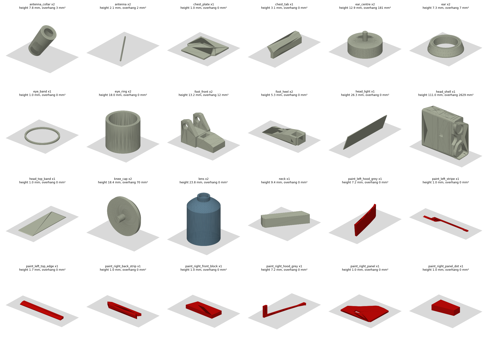
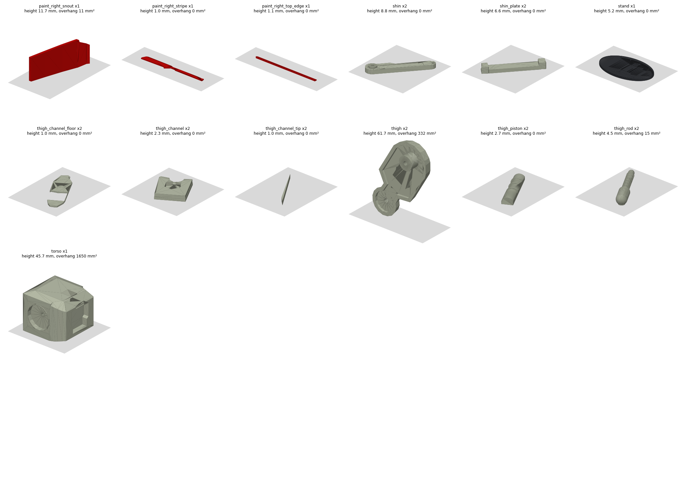

# 打印与装配指南

中文 · [English](PRINTING.en.md)

`stl/` 里有 54 个零件，每个零件一个 STL，默认头顶高 190 mm。STL 的坐标就是装配位置，导入切片软件后每个零件都要自己摆平，摆放方向见下表。零件之间的配合间隙是按 0.4 mm 喷嘴的 FDM 打印设的，没有在 SLA 上试过。

> 本页的摆放方向和参数是从模型几何算出来的建议值，没有实际打印验证过。第一次打印建议先打头壳以外的小件试配合，再打大件。

## 准备

**材料和工具**

| 项目 | 规格 | 用在哪 |
|---|---|---|
| 钢棒、铝棒或 M3 螺丝 | 3 mm | 髋销 1 根 3×65 mm；膝销 2 根 3×8 mm；踝销 2 根 3×12 mm |
| 黄铜棒 | 2 mm，每根约 76 mm，共 2 根 | 天线（打印的 antenna 只有 2.1 mm 粗，容易断，当备用） |
| CA 胶或 AB 胶 | | 所有嵌件、大腿内的小件、脚 |
| 底漆、米白喷漆、深灰渗线液 | | 上色（只想分色打印就不需要） |
| 小钻头 | 3.3 mm、2.3 mm | 孔打印后偏紧时扩孔 |

**打印参数（建议）**

- 喷嘴 0.4 mm，PLA 即可。小件和薄嵌件用 0.12–0.16 mm 层高；螺杆、螺纹柱想要清晰螺纹，用 0.2 mm 喷嘴或 0.08 mm 层高。
- 头壳等大件：2–3 层壁，10–15 % 填充。
- 默认 190 mm 高。想要接近真人大小，导出时设 `BD1_HEIGHT=316`（见 README），销孔和胶缝大小不变，五金件不用换。
- 先打一个厚 1 mm 的嵌件（比如 `paint_right_panel`）去试装头壳上的凹槽。每边 0.2 mm 的胶缝如果太紧或太松，就是你的打印机公差问题，调整“水平扩张”或回到 `bd1_model.py` 里改间隙再导出。

## 零件清单

每个零件都已转到悬垂面积最少的方向，下面的图和表就是这个结果（`render_print_layout.py` 生成，会重新计算）。图里灰色的是打印床，标题给出打印高度和悬垂面积。悬垂面积指朝下倾斜超过 45° 又不贴床的面，数值大的零件要加支撑。想直接在 3D 里看，打开网页（见 README 的“网页”一节），切到“打印板”。

数量已把左右两件算进去；颜色写“米白”这类名称，也可以全部打成白色再手涂。悬垂面积大于 150 mm² 的标为需要支撑，这只是几何估算，没有按具体切片软件验证，以你的切片预览为准。

| 零件 | 数量 | 颜色 | 打印高度 mm | 悬垂面积 mm² | 支撑 |
|---|---|---|---|---|---|
| `antenna` 天线 | 2 | 米白 | 2.1 | 2 | 基本不需要 |
| `antenna_collar` 天线套 | 2 | 炭灰 | 7.79 | 3 | 基本不需要 |
| `ear` 耳盘外圈 | 2 | 暖米白 | 7.35 | 7 | 基本不需要 |
| `ear_centre` 耳盘中心 | 2 | 中灰 | 12.9 | 181 | 需要 |
| `foot_front` 脚前半段 | 2 | 浅灰绿 | 13.2 | 12 | 基本不需要 |
| `head_shell` 头壳 | 1 | 米白 | 111.0 | 2628 | 需要 |
| `knee_cap` 膝盖盖 | 2 | 中灰 | 18.39 | 70 | 基本不需要 |
| `paint_right_snout` 头侧涂装嵌件 | 1 | 亮红 | 11.69 | 11 | 基本不需要 |
| `thigh` 大腿 | 2 | 暖米白 | 61.7 | 332 | 需要 |
| `thigh_rod` 螺杆 | 2 | 中灰 | 4.52 | 15 | 基本不需要 |
| `torso` 躯干 | 1 | 米白 | 45.7 | 1650 | 需要 |
| `chest_plate` 胸板 | 1 | 灰 | 1.0 | 0 | 基本不需要 |
| `chest_tab` 胸口红块 | 1 | 暗红 | 3.1 | 0 | 基本不需要 |
| `eye_band` 右眼红环 | 1 | 亮红 | 1.0 | 0 | 基本不需要 |
| `eye_ring` 眼筒 | 2 | 浅灰 | 18.0 | 0 | 基本不需要 |
| `foot_heel` 脚后半段 | 2 | 深灰 | 5.3 | 0 | 基本不需要 |
| `head_light` 灯板 | 1 | 绿 | 26.32 | 0 | 基本不需要 |
| `head_top_band` 头顶带 | 1 | 灰 | 1.0 | 0 | 基本不需要 |
| `lens` 镜头 | 2 | 镜头浅灰 | 23.8 | 0 | 基本不需要 |
| `neck` 脖子 | 1 | 米白 | 9.4 | 0 | 基本不需要 |
| `paint_left_hood_grey` 头侧涂装嵌件 | 1 | 灰 | 7.2 | 0 | 基本不需要 |
| `paint_left_stripe` 头侧涂装嵌件 | 1 | 亮红 | 1.0 | 0 | 基本不需要 |
| `paint_left_top_edge` 头侧涂装嵌件 | 1 | 灰 | 1.7 | 0 | 基本不需要 |
| `paint_right_back_strip` 头侧涂装嵌件 | 1 | 亮红 | 1.0 | 0 | 基本不需要 |
| `paint_right_front_block` 头侧涂装嵌件 | 1 | 亮红 | 1.0 | 0 | 基本不需要 |
| `paint_right_hood_grey` 头侧涂装嵌件 | 1 | 灰 | 7.2 | 0 | 基本不需要 |
| `paint_right_panel` 头侧涂装嵌件 | 1 | 灰 | 1.0 | 0 | 基本不需要 |
| `paint_right_panel_dot` 头侧涂装嵌件 | 1 | 亮红 | 1.0 | 0 | 基本不需要 |
| `paint_right_stripe` 头侧涂装嵌件 | 1 | 亮红 | 1.0 | 0 | 基本不需要 |
| `paint_right_top_edge` 头侧涂装嵌件 | 1 | 灰 | 1.14 | 0 | 基本不需要 |
| `shin` 小腿 | 2 | 暖灰 | 8.84 | 0 | 基本不需要 |
| `shin_plate` 小腿红板 | 2 | 暗红 | 6.6 | 0 | 基本不需要 |
| `stand` 底座 | 1 | 黑灰 | 5.2 | 0 | 基本不需要 |
| `thigh_channel` 槽上段凸块 | 2 | 暗红 | 2.3 | 0 | 基本不需要 |
| `thigh_channel_floor` 槽底 | 2 | 深棕 | 1.0 | 0 | 基本不需要 |
| `thigh_channel_tip` 槽顶小块 | 2 | 深棕 | 1.0 | 0 | 基本不需要 |
| `thigh_piston` 螺纹柱 | 2 | 中灰 | 2.66 | 0 | 基本不需要 |

共 54 个。打印时间和耗材没有测量过，所以这里不写数字。

## 装配步骤

1. **试配**：先不涂胶，把所有嵌件放进各自的凹槽里，确认能放平。太紧的先用锉刀轻磨，不要硬压。
2. **头部**
   1. 把头顶带、两侧的 paint_* 涂装件、右眼红环按凹槽方向粘进头壳，注意罩壳上的红块和灰块要贴着弧面。右侧（-y）和左侧（+y）图案不同，别装反。
   2. 灯板粘在头后凹槽的底上。
   3. 眼筒插进面板上 6 mm 深的眼窝，再把镜头塞进眼筒。右眼是钢蓝的大镜头，左眼是浅灰的。
   4. 耳朵：中心灰件用它自带的 3 mm 凸销插进头侧，再把外圈套在它外面粘到头侧。
   5. 天线：先套上 antenna_collar，再把黄铜棒插进耳盘外圈上的 2.3 mm 斜孔。
3. **躯干**：胸板粘在胸口凹槽底，胸口红块粘在正面和顶部斜面的交界处。
4. **脖子**：两端各插进 8 mm 的斜孔（一头头壳，一头躯干）。
5. **大腿**
   1. 先把深棕的槽底、槽顶小块和暗红的凸块拼进槽里。
   2. 螺杆粘在槽底上，粗的一头对准六角凹坑下方，螺纹柱粘进侧槽。
   3. 膝盖盖压进膝盖的凹槽。
6. **小腿**：红板嵌进 1 mm 凹槽，会凸出小腿表面，凸耳在两头。
7. **脚**：深色后半段和浅色前半段在 x = 40.5 处对接粘牢，踝叉在前半段上。
8. **关节**（只靠摩擦定位，不要涂胶）
   - **髋**：大腿内侧的轮毂伸进躯干侧面的圆形凹坑，一根 3×65 mm 的销穿过左大腿、躯干、右大腿。
   - **膝**：每侧一根 3×8 mm 的销，从小腿内侧穿进去，外侧由膝盖盖自带的短销堵住。
   - **踝**：每侧一根 3×12 mm 的销，穿过脚上的叉口和小腿末端。
9. **底座（必需）**：把两只脚粘进底座的 1.2 mm 凹槽里。重心在脚跟后面约 4.5 mm，只靠两只脚站不住。

## 上色

先喷底漆，再喷米白。红色、灰色和深色部分都是单独零件，不需要遮盖。耳朵外圈的 0.6 mm 细槽里描一圈红线。最后用深灰渗线液填面板线、耳朵环槽、大腿侧槽和脚上的通槽。脏污、划痕、渐变和小于约 3 mm 的色块只存在于参考贴图里，要靠手涂做旧。

## 对应拜博（Bambu Lab）PLA Basic 的颜色

上面的色值是从参考贴图测的，**没有**按拜博色号对齐。下表是把每个色值在 Lab 空间里找最接近的 PLA Basic 颜色，仅供选线材参考。

- 拜博的色值来自 [论坛网友整理的列表](https://forum.bambulab.com/t/color-picker-include-hex-codes-and-closest-bambu-color-code/171046)，不是官方数据，实际颜色以线材实物和官网为准。
- 这里只写颜色名，不写色号：那份列表里大多数颜色没有色号，我没有核实，写错了会让人买错线。
- 差距（ΔE）大于 15 的，是 PLA Basic 里没有真正接近的颜色，建议打成白色或 Beige 后手涂。

| 本项目颜色 | 色值 | 最接近的 PLA Basic | ΔE |
|---|---|---|---|
| 灰 | `#999996` | Gray | 4.4 |
| 中灰 | `#82827D` | Gray | 5.4 |
| 暖灰 | `#80786B` | Gray | 10.3 |
| 深灰 | `#595952` | Dark Gray | 4.7 |
| 炭灰 | `#424242` | Dark Gray | 7.7 |
| 镜头浅灰 | `#B2B5B2` | Silver | 4.9 |
| 浅灰 | `#B8BAB0` | Silver | 8.5 |
| 暖米白 | `#B2A696` | Silver | 11.0 |
| 亮红 | `#C40A08` | Red | 11.7 |
| 黑灰（底座） | `#33363B` | Dark Gray | 13.7 |
| 深棕 | `#593D36` | Cocoa Brown | 14.8 |
| 暗红 | `#7A2B26` | Brown | 15.2 |
| 钢蓝 | `#638599` | Blue Grey | 13.7 |
| 浅灰绿 | `#B2B59E` | Silver | 13.5 |
| 绿 | `#52A624` | Bambu Green | 16.9 |
| 深红褐 | `#5E3330` | Cocoa Brown | 17.9 |
| 米白（头壳、躯干等大件） | `#C9CFB0` | Light Gray 或 Beige | 17.7 / 18.1 |

大件的米白没有好的对应色，用 Beige 或 Jade White 打印后喷米白最稳。

## 常见问题

- **孔太紧**：销孔是 3.3 mm、天线孔是 2.3 mm，打印机偏胀就用钻头过一遍。
- **嵌件放不平**：多半是边缘首层外扩（象脚），把底面首层缩一点，或者倒角后再装。
- **薄嵌件翘边**：1 mm 厚的红色和灰色嵌件最容易翘，用低温床和边缘加粘，或者把几张薄嵌件一起摆在中间打。
- **头壳要不要支撑**：按几何估算，头壳（侧面朝下）有约 2600 mm² 的悬垂面，README 里写的是“几乎不用支撑”，两边不一致，没有实际打印验证。以切片软件的预览为准，先打一个试试。
- **关节松**：靠摩擦定位的销孔太松时，换粗一点的销，或者在销上抹一点点胶但不要粘住。
