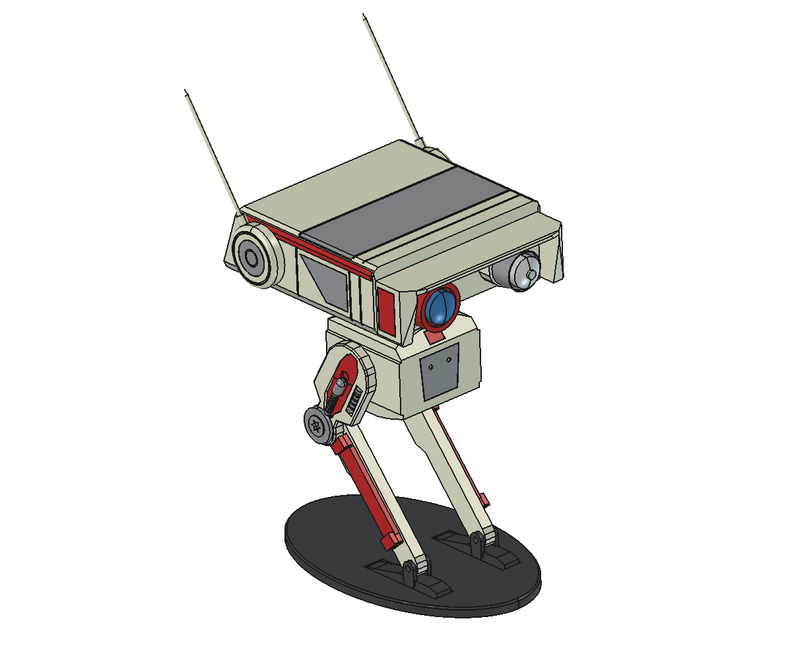

# openbd1：BD-1 分模块打印模型（FreeCAD）

中文 · [English](README.en.md)

外形按 `bd-1-droid-star-wars-jedi-fallen-order/` 里的参考网格测量建模。头、躯干、大腿、小腿、脖子的轮廓都是从参考网格上描下来的。面部罩壳、耳盘、胸背凹槽、大腿上的螺杆和螺纹柱、小腿红板凸耳、脚和踝叉这些细节，是从参考网格六个方向的表面高度图上量出来的。每个颜色区域都是单独零件，可以分色打印，也可以全部打成白色再分件上色。零件之间用 3 mm 销和胶连接。



与参考网格的正交视图对比（对比图 `compare_sheet.png` 含参考贴图，不随仓库发布，用 `compare.py` 自己生成）：

| 视图 | 轮廓重合度 IoU |
|---|---|
| 正视 | 0.976 |
| 侧视 | 0.983 |
| 俯视 | 0.994 |

表面起伏用 `depth_diff.py` 从前、后、左、右、上、下六个方向逐点对比（0.5 mm 一个像素）。剩下的偏差区域都在 66 mm² 以内，平均偏差约 2 mm 以内，多数是零件边缘一个像素宽的条带。颜色是参考贴图在每个表面上的面积加权平均值（见下面的颜色表）。

主要细节：
- **面部**：口鼻部分是一个拱形罩壳，两侧弧面上有灰色块：顶板 2.5 mm 厚，两侧外沿弧形收进成薄侧壁。罩壳里的面板退后 10–16 mm，下沿是护目镜形状，一直伸到下巴的两个小凸块；两眼中间是一条通到顶板的竖槽。主头正面在鼻子下方有拱形缺口，顶部中间有一个梯形凹口。
- **眼睛**：右眼眼筒是深红褐色，正面有一圈 1.5 mm 宽的亮红环，镜头是钢蓝色、圆顶高 5 mm，眼筒里有一圈退后的内沿；左眼眼筒浅灰、没有内沿，镜头中心是一圈凸起的小环，环里是浅窝。
- **耳朵**：外圈平沿带 45° 倒角，平沿上有一道 0.6 mm 细槽，用来涂红线；中心灰件依次是锥面、深环槽、凸起的轮毂和中心小窝。天线沿参考上拟合出的直线伸出，根部有一个 7 mm 长的深灰锥形套。
- **头后**：斜面上有一块下沉 3 mm 的绿色灯板，凹槽下沿是直边，上沿和两侧是约 4 mm 宽的斜边。
- **躯干**：俯视时两侧向前收窄，顶面和侧面之间的棱边有斜面，越往前斜面越宽；灰色胸板退在正面后 5.2 mm，红色小块在正面和顶部斜面交界处；背面有一块下沉 4 mm、带斜边的面板。两侧髋部各有一个圆形凹坑，四周一圈凸起的窄边。
- **大腿**：大腿板是一个浅托盘，内侧是空的，四周有一圈卷边。外侧有一道槽，槽底比板面低 1.5 mm，是深棕色的，上面横着一根灰色螺杆，上粗下细；槽上段有一块几乎和板面齐平的红色凸块，上面有一个六角凹坑。槽旁边的侧槽里放一根灰色螺纹柱。螺杆和螺纹柱的轴线、粗细和高度是在参考截面上拟合圆得到的。板边是陡斜面：外表面比轮廓小 1.25 mm，几乎一直斜到内侧。膝盖螺栓盖照参考的剖面旋转成形：斜边底座、一圈台阶、一道窄槽、凸台，中间是圆形凹坑，四周留一圈可见的缝；膝关节中心按螺栓盖的拟合圆心定位。
- **头侧涂装**：参考贴图两侧不一样，这里也照做。右侧（-y）有灰色侧板（板上一个红点）、靠上的长红条、前端红块、后下方红条和口鼻弧面上的红块；左侧（+y）只有一条位置更低的红条。两侧顶边都有一条灰色窄条，接着头顶的灰带。
- **小腿**：外侧红板高出 2.7 mm，两头各有一个凸耳，凸耳高出 5.6 mm。
- **脚**：脚跟薄、往前加厚到 5.3 mm、前端斜面收口，板上有两条槽（底部留 0.4 mm）；踝叉是两片异形侧板，中间有一块矮横梁。脚后半段深色，前半段和踝叉浅色。

和参考不一样、而且有意不改的地方（为了能打印和装配）：
- **髋部连接**：参考模型的大腿和躯干其实是分开悬空的；这里在大腿内侧加了一个藏在髋部凹坑里的轮毂，用来穿髋销。
- **配合**：嵌件凹槽每边留 0.2 mm 胶缝，关节有 3.3 mm 销孔，天线根部有 2.3 mm 插孔。
- **脚槽**：参考的槽底厚度是 0，打印件留了 0.4 mm。
- **底座**：参考没有底座，但打印件不靠底座站不住。

做不到完全一致的地方：
- **网格细节**：参考是 60 万个三角面的雕刻网格，这里是 FreeCAD 实体。在 0.5 mm 的比较精度下，剩下的偏差集中在零件边缘的一个像素、膝盖周围几处 1–2 mm 的小区域，以及凹槽里看不见的机械细节（例如髋部凹坑底面）。
- **贴图细节**：脏污、划痕、渐变和小于约 3 mm 的色块只存在于贴图里，不是形状，所以只能靠手涂做旧。

## 许可与声明

- 脚本（`*.py`）：MIT，见 `LICENSE`。
- 模型文件（`BD1.FCStd`、导出的 STL、`preview.png`）：CC BY-NC-SA 4.0，禁止商用，见 `LICENSE-MODEL`。不要出售打印件。
- BD-1 是 Lucasfilm / Disney 的角色，本仓库是非官方的非商业同人作品，与他们无关。
- 测量用的参考网格没有许可证说明，没有放进本仓库（`ref/` 和参考文件夹都在 `.gitignore` 里），请自己准备，仅供个人使用。

## 文件

| 文件 | 作用 |
|---|---|
| `bd1_model.py` | 参数化模型：尺寸、轮廓、关节位置、配合间隙都在文件里 |
| `BD1.FCStd` | 带颜色的 FreeCAD 装配文件 |
| `stl/*.stl` | 每个零件一个 STL（54 个），坐标就是装配位置，打印前要在切片软件里平放 |
| `export_stl.py` | 重新生成 STL |
| `preview_gui.py` | 重新生成带颜色的 `BD1.FCStd` 和 `preview.png` |
| `check_fit.py` | 检查零件之间有没有互相穿插，并输出重心位置 |
| `glb_ref.py` | 读取参考 GLB（带骨骼蒙皮和贴图颜色），换成本项目的坐标和尺寸，存为 `ref/bd1_ref.npz` |
| `ref_profiles.py` | 从参考网格描出零件的二维轮廓，用来更新 `bd1_model.py` 里的轮廓点 |
| `render_views.py` | 输出模型和参考网格的正视、侧视、俯视正交渲染，存到 `views/` |
| `compare.py` | 对比两者的轮廓，输出 IoU、逐段偏差（mm）和叠加图 |
| `depth_diff.py` | 从六个方向对比表面高度，输出差异图 `views/depth_<方向>.png` 和差异最大的区域（约 4 分钟）；可以只给方向名，比如 `depth_diff.py left front` |
| `heightmap.py` | 把三角网格栅格化成高度图，`depth_diff.py` 和测量参考网格时都用它 |

改完尺寸后重新生成：

```bash
cd ~/bdx/openbd1 && /Applications/FreeCAD.app/Contents/Resources/bin/freecadcmd export_stl.py
```

尺寸用 `BD1_HEIGHT` 控制，表示头顶高度（mm），默认 190。`BD1_HEIGHT=316` 接近真人大小。外形整体缩放，销孔、天线孔和胶缝保持实际尺寸不变，所以五金件不用换。

打印和装配的完整步骤、零件清单和线材对照见 [PRINTING.md](PRINTING.md)（英文：[PRINTING.en.md](PRINTING.en.md)）；想在浏览器里拖动、拆开、看打印板排版，见下面的“网页”一节。

## 零件与颜色

颜色取自参考贴图，是每个表面上的面积加权平均值。

| 颜色 | 色值 | 零件 |
|---|---|---|
| 米白 | `#C9CFB0` | head_shell, neck, torso, antenna ×2 |
| 暖米白 | `#B2A696` | thigh ×2, ear ×2 |
| 暖灰 | `#80786B` | shin ×2 |
| 灰 | `#999996` | head_top_band, paint_*_top_edge, paint_right_panel, paint_*_hood_grey, chest_plate |
| 中灰 | `#82827D` | ear_centre ×2, knee_cap ×2, thigh_rod ×2, thigh_piston ×2 |
| 浅灰 | `#B8BAB0` | eye_ring_left |
| 镜头浅灰 | `#B2B5B2` | lens_left |
| 亮红 | `#C40A08` | paint_right_stripe, paint_right_panel_dot, paint_right_front_block, paint_right_back_strip, paint_right_snout, paint_left_stripe, eye_band_right |
| 暗红 | `#7A2B26` | shin_plate ×2, thigh_channel ×2（槽上段凸块）, chest_tab |
| 深红褐 | `#5E3330` | eye_ring_right |
| 钢蓝 | `#638599` | lens_right（BD-1 自己的右眼，较大） |
| 绿 | `#52A624` | head_light |
| 深棕 | `#593D36` | thigh_channel_floor ×2, thigh_channel_tip ×2 |
| 深灰 | `#595952` | foot_heel ×2 |
| 浅灰绿 | `#B2B59E` | foot_front ×2 |
| 炭灰 | `#424242` | antenna_collar ×2 |
| 黑灰 | `#33363B` | stand（不属于 BD-1） |

## 装配

- **五金件**：
  - 3 mm 钢棒、铝棒或 M3 螺丝，销孔 3.3 mm，关节可以转动，靠摩擦定位。
    - 髋：一根 3×65 mm 的销，穿过左大腿、躯干、右大腿。
    - 膝：每侧一根 3×8 mm 的销，从小腿内侧穿进去；外侧由 knee_cap 自带的 3 mm 短销堵住。
    - 踝：每侧一根 3×12 mm 的销，穿过脚上的叉口和小腿末端。
  - 天线：2 mm 黄铜棒，每根约 76 mm，先套上 antenna_collar 锥形套，再插进耳盘外圈上 2.3 mm 的斜孔。也可以用打印的 antenna 零件，但只有 2.1 mm 粗，很容易断。
- **胶粘件**：凹槽每边留了 0.2 mm 间隙，用 CA 胶或 AB 胶。
  - 嵌件嵌进 1 mm 深的凹槽：头顶带、两侧的 paint_* 涂装件（罩壳上的红块和灰块贴着弧面）、胸口红块、右眼眼筒正面的红环。灯板和胸板粘在各自凹槽的底上。小腿红板也是嵌进 1 mm 凹槽，但会凸出小腿表面。
  - 大腿：先把深色槽底、槽顶小块和红色凸块拼进槽里，再把螺杆粘在槽底上（螺杆粗的一头对准六角凹坑下方），螺纹柱粘进侧槽，膝盖盖压进膝盖的凹槽。
  - 眼筒插进面板上 6 mm 深的眼窝，再把镜头塞进眼筒。
  - 耳朵：中心灰件用自带的 3 mm 凸销插进头侧，再把外圈套在它外面粘到头侧上。
  - 脖子两端各插进 8 mm 的斜孔。
  - 脚：深色后半段和浅色前半段在 x = 40.5 处对接粘牢，踝叉在前半段上。
  - 髋：大腿内侧的轮毂伸进躯干侧面的圆形凹坑，髋销穿过轮毂和躯干。
- **底座（必需）**：重心在脚跟后面约 4.5 mm（重心 x 5.0，脚跟 x 9.5），只靠两只脚站不住。必须把脚粘进 stand 的 1.2 mm 凹槽里。

## 打印建议

- **头壳**：最大的件，137×111×40 mm。侧面朝下平放打印，这样罩壳顶板、侧壁和面板都是竖直的，几乎不用支撑。实心建模，用 2–3 层壁、10–15 % 填充。
- **螺杆、螺纹柱**：平的底面朝下打印。螺纹凸棱只有 0.25–0.3 mm，用 0.2 mm 喷嘴或 0.08 mm 层高会更清楚；也可以直接用 3 mm 螺丝截一段代替螺杆。
- **腿件、脚**：侧面平放打印，层线顺着腿的方向。
- **薄嵌件**：大多是 1 mm 厚，平放打印。用 0.4 mm 喷嘴、0.12–0.16 mm 层高。
- **上色**：先上底漆，再喷米白。红色、灰色和深色部分是单独零件，不需要遮盖。耳朵外圈的细槽里描一圈红线。最后用深灰渗线液填面板线、耳朵环槽、大腿侧槽和脚上的通槽。

## 网页

`web/` 是一个 Vite 项目：用真实 STL 做成的 3D 模型，可以拖动旋转、拆开、摆到打印板上，每一步装配都能点开高亮对应零件。three.js 和字体都从 npm 装进来、打进产物，部署后不依赖任何 CDN。页面支持中文和英文：默认跟随浏览器语言，右上角的按钮可以切换，选择会记在浏览器里。所有文案在 `web/src/i18n.js`，要改措辞或加语言只动这一个文件。

```bash
cd web
npm install
npm run dev        # 本地开发，http://localhost:5173
npm run build      # 产物在 web/dist，纯静态文件
```

线上地址：https://openbd1.haiwang.ai/

**部署到 GitHub Pages**：推到 GitHub 后，在仓库 Settings → Pages 里把 Source 选成 “GitHub Actions”。之后每次推送 `main` 上 `web/` 的改动，`.github/workflows/pages.yml` 会自己跑 `npm ci && npm run build` 并发布 `web/dist`。资源路径是相对的，所以绑自定义域名（现在用的是 `openbd1.haiwang.ai`）或放在 `https://用户名.github.io/openbd1/` 这样的子路径下都能用。

页面读 `web/public/data/` 里的压缩网格，这份数据是提交进仓库的，所以部署不需要 FreeCAD。改了模型之后在本机重新生成，再提交：

```bash
cd ~/bdx/openbd1
/Applications/FreeCAD.app/Contents/Resources/bin/freecadcmd export_stl.py
/Applications/FreeCAD.app/Contents/Resources/bin/python -I render_print_layout.py
/Applications/FreeCAD.app/Contents/Resources/bin/python -I pack_web.py
```

## 与参考网格对比

```bash
cd ~/bdx/openbd1
/Applications/FreeCAD.app/Contents/Resources/bin/python -I glb_ref.py
/Applications/FreeCAD.app/Contents/Resources/bin/freecadcmd render_views.py
/Applications/FreeCAD.app/Contents/Resources/bin/python compare.py
/Applications/FreeCAD.app/Contents/Resources/bin/freecadcmd depth_diff.py
```

两者按世界坐标对齐，比例都是 6 px/mm，所以不需要拟合，偏差直接以 mm 读出。

`views/<view>_overlay.png` 的颜色：灰色是两者重合，红色是只有模型有，蓝色是只有参考有。`views/<view>_ghost.png` 是带贴图的参考和模型半透明叠在一起。

也可以改用截图对比：把 `front.png`、`side.png`、`top.png` 放进 `ref/`，`compare.py` 会优先用截图，并自动搜索缩放、镜像和平移。背景要用纯色，或者另外提供 `ref/<view>_mask.png`。
